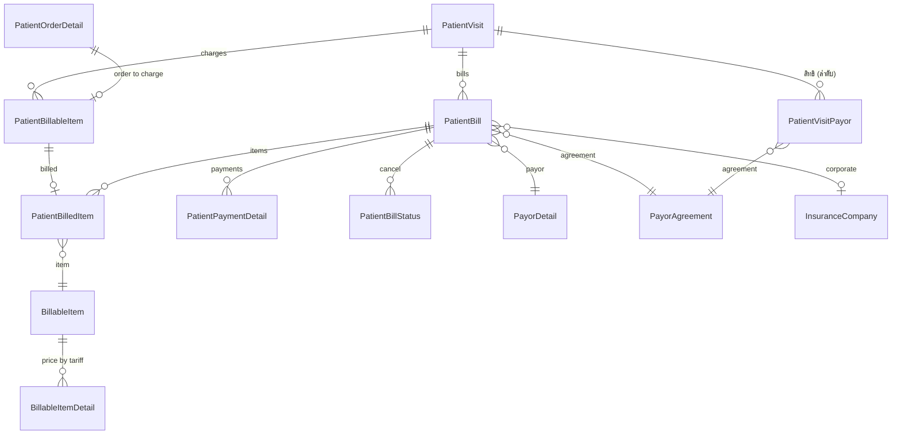

# การเงิน (Billing / Payment / สิทธิ / ลูกหนี้) — ฐาน HealthObject

สำรวจเมื่อ 2026-10-22 จาก metadata, นิยาม SP/view และสถิติรวมเท่านั้น (ไม่มีข้อมูลผู้ป่วยในเอกสารนี้)
ระดับความมั่นใจของความสัมพันธ์: `seen-in-sp` = พบใน SP/view ของ HO, `tested` = ทดสอบ JOIN กับข้อมูลจริงแล้ว, `inferred` = อนุมานจากชื่อ

---

## 1. วิธีเชื่อมต่อฐาน

ใช้เครื่องมือใน `tools/` ที่รากโปรเจกต์ (`D:\AI\HO63Database`) เท่านั้น — ห้ามต่อด้วย SSMS/เครื่องมืออื่นเพื่อสำรวจ เพราะบัญชีอาจมีสิทธิ์สูง

| สิ่งที่ต้องมี | รายละเอียด |
|---|---|
| Node.js + แพ็กเกจ | `npm install` ครั้งแรก (`mssql`, `dotenv`) — ถามผู้ใช้ก่อนติดตั้ง |
| ไฟล์ `.env` ที่ราก folder | คีย์ `HIS_DB_HOST`, `HIS_DB_PORT` (ค่าเริ่มต้น 1433), `HIS_DB_NAME`, `HIS_DB_USER`, `HIS_DB_PASSWORD`, `HIS_DB_TRUST_CERT` — **ห้ามแสดงหรือคัดลอกค่า** |
| ตัวเชื่อม | `tools/db.mjs`: `encrypt:false`, `readOnlyIntent:true`, `useUTC:false` (เวลาในฐานเป็นเวลาไทย) |
| guard | รับเฉพาะคำสั่ง `SELECT`/`WITH` เดียว, ทำในทรานแซกชันที่ **rollback เสมอ**, timeout 15 วินาที |
| `tools/query.mjs` | ห้าม `SELECT *`, mask คอลัมน์ที่ชื่อเหมือน PHI (HN, ชื่อ, เบอร์ ฯลฯ), แสดงสูงสุด 50 แถว |

```bash
npm run ping                                                    # ทดสอบการเชื่อมต่อ
node tools/query.mjs "SELECT COUNT(*) n FROM PatientBill WITH (NOLOCK) WHERE BillGeneratedDttm >= '2026-10-01'"
node tools/query.mjs -f .claude/skills/healthobject-db/reference/queries/finance-revenue.sql --param from=2026-09-01 --param to=2026-10-01
```

ข้อควรรู้: ฐานนี้เป็น **replica แบบ transactional replication** (มี `sp_MSins_/sp_MSupd_/sp_MSdel_` 267 ตัวสำหรับตารางการเงิน) — ข้อมูลสดเกือบ real-time
**ห้าม EXEC SP ใด ๆ** — อ่านนิยามด้วย `sys.sql_modules` แล้วเขียน SELECT เอง (ดู §6)

---

## 2. Flow ข้อมูลการเงิน

```
สั่ง order ─► PatientOrderDetail ─► PatientBillableItem ─► (ออกบิล) PatientBill ─┬─► PatientBilledItem (รายการในบิล)
             (สั่ง)                (ค่าใช้จ่ายที่เกิด/ยังไม่ออกบิลได้)            ├─► PatientPaymentDetail (รับเงิน / คืนเงิน / มัดจำ)
                                                                              ├─► PatientBillStatus (ยกเลิกบิล)
สิทธิของ visit: PatientVisitPayor (ลำดับ 1..10) ─► PayorAgreement / PayorDetail / InsuranceCompany
ลูกหนี้สิทธิ: PatientBill (CREDBL, IsPaymentComplete='N') ─► AR interface (pRepCSInterfaceAR*, xInterfaceARPayorCode)
เบิกจ่าย สปสช./กรมบัญชีกลาง: pRepCSDataToDBFFile_* (ไฟล์ส่งเบิก), PatientDRGDetail (DRG)
```

- ผู้ป่วย 1 visit มี **หลายบิลได้** — แยกตาม payor (บิลเครดิตต่อสิทธิ + บิลเงินสดส่วนที่ผู้ป่วยจ่ายเอง)
- `BillNumber` ขึ้นต้น `O` = บิล OPD, `I` = บิล IPD (ใน AR interface ตัดบิลที่ขึ้นต้น `O` ออก)
- สถานะ flow ของ visit ด้านการเงินอยู่ที่ `PatientServiceEvent`: `BLINP` (44764) Billing In-progress → `FINDIS` (44225) Financial Discharge ดู [service-points.md](service-points.md)

---

## 3. ตารางหลัก

🔒 = มี PHI. จำนวนแถวจาก `raw/tables.csv`

| ตาราง | แถว | ความหมาย | คอลัมน์สำคัญ | index |
|---|---|---|---|---|
| `PatientBill` | 1.2M | หัวบิล/ใบเสร็จ/ใบแจ้งหนี้ | `PatientVisitUID`, `PatientUID`, `BillNumber`, `BillGeneratedDttm`, `BLCATUID`, `BLTYPUID`, `PBLCTUID`, `PayorUID`, `PayorAgreementUID`, `CorporateUID`, `PatientVisitPayorUID`, `IsPaymentComplete`, `IsRefund`, `RefundBillNumber`, `DiscountAmount`, `TotalAmount` (ดู §5), 🔒`PatientName`, 🔒`MobileNumber` | BillGeneratedDttm (incl IsRefund), PatientVisitUID, PatientUID, BillNumber, BLCATUID, PayorAgreementUID |
| `PatientBilledItem` | 27M | รายการในบิล | `PatientBillUID`, `PatientBillableItemUID`, `BillableItemUID`, `ItemName`, `Amount` (ราคาต่อหน่วย), `ItemMultiplier`, `Discount`, `RoundOff`, `NetAmount`, `BSMDDUID` (หมวด), `BillPackageUID`, `PatientPackageItemUID`, `CareProviderUID` | PatientBillUID (incl BillableItemUID, StatusFlag), PatientBillableItemUID, BillableItemUID |
| `PatientBillableItem` | 23M | ค่าใช้จ่ายที่เกิดขึ้น (ก่อน/หลังออกบิล) | `PatientVisitUID`, `PatientOrderDetailUID`, `BillableItemUID`, `PatientVisitPayorUID`, `PayorUID`, `NetAmount`, `EventOccuredDttm`, `GroupUID`/`SubGroupUID` + `*Coverage`/`*Covered` (วงเงินสิทธิ), `ReceiptNumber` | PatientVisitUID, PatientOrderDetailUID, EventOccuredDttm, PatientVisitPayorUID |
| `PatientPaymentDetail` | 403K | การรับเงิน/คืนเงิน/มัดจำ | `PatientBillUID` (0 = มัดจำ), `PAYMDUID`, `Amount`, `SpecialAmount`, `PaidDttm`, `RecieptNumber` (สะกดผิดในฐาน), `IsRefund`, `RefundReceiptNumber`, `IsAdvance`, `ParentReceiptNumber`, `CounterNumber`, 🔒`CardNumber`, `BankName` | PatientBillUID, PaidDttm, PatientVisitUID, PatientUID |
| `PatientBillStatus` | 39K | บันทึกการยกเลิกบิล | `PatientBillUID`, `CancelledBy`, `CancelledDttm`, `DocumentNo`, `PatientPaymentDetailUID` | |
| `PatientVisitPayor` | 1.9M | สิทธิของ visit (หลายลำดับ) | `PatientVisitUID`, `PAYRTPUID` (ลำดับ), `PayorUID`, `PayorAgreementUID`, `CorporateUID`, `PBLCTUID`, `EligibileAmount`, `ClaimPercentage`, `CoveredAmount`, 🔒`IDCardNumber` | (PatientVisitUID, PatientUID, StatusFlag), PayorAgreementUID, PayorUID |
| `PatientVisitPayorAddlnDetail` | 3.8M | ข้อมูลเพิ่มของสิทธิ (key/value) | `PatientVisitPayorUID`, `AttributeCode`, `AttributeName`, `AttributeValue` | |
| `PatientInsuranceDetail` | 238K | กรมธรรม์/บัตรประกันของผู้ป่วย | `InsuranceCompanyUID`, `PayorAgreementUID`, `PolicyNumber`, 🔒`CardNumber`, `EligibleAmount` | |
| `PatientNHSO` | 359K | ผลตรวจสิทธิ สปสช. (≈1 แถว/คน) | `PERSON_ID` (= เลขบัตร 🔒), `MAININSCL`, `SUBINSCL`, `HMAIN`, `HSUB`, 🔒`FNAME`/`LNAME`/`BIRTHDATE` | PERSON_ID |
| `PatientDueSettlement` / `PatientSettledBill` | 75 | ชำระหนี้ค้างของบริษัทคู่สัญญา | `CorporateUID`, `BillAmount`, `PaidAmount`, `WriteOff` | ใช้น้อย |
| `PatientDRGDetail` | 61K | ข้อมูล DRG (ผู้ป่วยใน) | | |

### Master (catalog)

| ตาราง | แถว | ความหมาย |
|---|---|---|
| `BillableItem` | 35K | รายการคิดเงิน (`Code`, `ItemName`, `ItemAmount`, `BSMDDUID` หมวด, `ServiceUID`, `ORDCTUID`, `ItemUID` → `ItemMaster`) — รหัสเด่นดู [codes.md](codes.md) |
| `BillableItemDetail` | 470K | ราคาตามสิทธิ/tariff (`PBLCTUID`, `CorporateUID`, `ENTYPUID`, `ItemAmount`, `ActiveFrom/To`) |
| `BillableItemPayorCode` | 54K | รหัสรายการของผู้จ่ายแต่ละราย (รหัสกรมบัญชีกลาง/สปสช.) |
| `BillPackage` / `BillPackageItem` | 391 / 10K | แพ็กเกจราคา |
| `PayorDetail` | 1,287 | ผู้จ่าย (`Code`, `PayorName`, **`PYRACATUID` กลุ่มผู้จ่าย**) |
| `PayorAgreement` | 1,123 | สัญญา/สิทธิ (`Code`, `Name`, `PrimaryPBLCTUID` tariff, `AGTYPUID`) |
| `InsuranceCompany` | 1,261 | บริษัท/หน่วยงานคู่สัญญา (`Code` ใช้เทียบ `PatientNHSO.MAININSCL`) |
| `InsurancePlan` | 4,276 | PayorAgreement × InsuranceCompany × PayorDetail |
| `BillingService`, `BillingAccount` | 81 / 57 | บัญชีรายได้/ส่วนลด (ผังบัญชี) |
| `setup*`, `Temp*`, `XL_*`, `*BKP` | | ตารางตั้งค่า/สำรองเก่า (2013–2017) — ไม่ใช้ |

---

## 4. ความสัมพันธ์ (JOIN)

| จาก | ไป | ระดับ |
|---|---|---|
| `PatientBill.PatientVisitUID` | `PatientVisit.UID` | seen-in-sp |
| `PatientBilledItem.PatientBillUID` | `PatientBill.UID` | tested |
| `PatientBilledItem.PatientBillableItemUID` | `PatientBillableItem.UID` | tested — 63,630/63,630 (100%) รายการ, `BillableItemUID` และ `NetAmount` ตรงกัน 100% |
| `PatientBillableItem.PatientOrderDetailUID` | `PatientOrderDetail.UID` | tested — 100% |
| `PatientBilledItem.BillableItemUID` | `BillableItem.UID` | seen-in-sp |
| `PatientPaymentDetail.PatientBillUID` | `PatientBill.UID` (0 = มัดจำไม่ผูกบิล) | seen-in-sp + tested |
| `PatientBill.PatientVisitPayorUID` | `PatientVisitPayor.UID` | seen-in-sp (`vQSHC_get_PatientBilled`) |
| `PatientBill.PayorUID`, `PatientVisitPayor.PayorUID` | `PayorDetail.UID` | seen-in-sp |
| `PatientBill.PayorAgreementUID` | `PayorAgreement.UID` | seen-in-sp |
| `PatientBill.CorporateUID`, `PatientVisitPayor.CorporateUID` | `InsuranceCompany.UID` | seen-in-sp |
| `PayorAgreement.PrimaryPBLCTUID` | `ReferenceValue` (tariff, domain `PBLCT` 16 ค่า) | seen-in-sp |
| `PayorDetail.PYRACATUID` | `ReferenceValue` (`PYRACAT` กลุ่มผู้จ่าย) | tested |
| `PatientBilledItem.BSMDDUID` | `ReferenceValue` (`BSMDD` หมวดค่าใช้จ่าย) | seen-in-sp |
| `PatientID.Identifier` (NATID 13692) | `PatientNHSO.PERSON_ID`; `PatientNHSO.MAININSCL` → `InsuranceCompany.Code` | seen-in-sp |



---

## 5. รหัสและกฎการคำนวณ (ตรวจกับข้อมูลจริง)

### รหัส (ReferenceValue)

| Domain | ค่า |
|---|---|
| `BLCAT` หมวดบิล | 4321 `OPBILL`, 4322 `IPBILL`, 4323 `ADVCC` Deposit, 4324 `REFUN`, 4325 `DUECC`, 64739 `OPMERG`, 64740 `IPMERG` |
| `BLTYP` ประเภทบิล | 2159 `CASHBL` เงินสด, 2160 `CREDBL` เครดิต/สิทธิ, 2161 `INSUBL`, 23377 `FRBLL` Free bill |
| `PBTYP` | 44749 `INVOC` Invoice, 44750 `RECEI` Receipt, 47110 `FBILL` |
| `PAYMD` วิธีชำระ | 1115 `CASHH` เงินสด, 1117 `CARDD` บัตร, 78921 `QRCODE`, 78920 `TRNFR` โอน, 78919 `PATIN` Pay in (SP เก่ายังอ้าง `CHEQU`, `COUPN`, `ONTRANS` ซึ่งไม่ active) |
| `PAYRTP` ลำดับสิทธิ | 13838 `PRIMARY` (1), 13839 `SECOND`, 22902 `THIRD`, 44797–47389 (4–10) |
| `PYRACAT` กลุ่มผู้จ่าย | A สปสช, B กรมบัญชีกลาง, C ประกันสังคม, D สังคมสงเคราะห์, E สปสช.(เหมาจ่าย), F เงินสด, G บริษัทประกัน, H รัฐวิสาหกิจ, I หน่วยงานเปิด Credit, J ค่าใช้จ่าย, K ลูกหนี้ทั่วไป, L ACRO, M สปสช(เฉพาะ), N/O ประกันสังคม(เฉพาะ/เหมาจ่าย), P/W อปท., Q ต่างด้าว, R ผู้มีปัญหาสถานะ, S พรบ., T สวัสดิการ มข., U ศูนย์หัวใจสิริกิติ์ฯ, V กรมบัญชีกลาง(โรคเฉพาะ), X หน่วยงานรัฐอื่น, Z อื่นๆ, 0 บัญชีส่วนเกินสิทธิ์ |
| `BSMDD` หมวดค่าใช้จ่าย | 1159 CONSU, 1160 LABBB, 1161 SURGE, 1162 ANEST, 1163 PROCE, 1164 IMPLA, 1165 THEAT, 1643 PACKA, 1646 ROOMM, 1703 NRSCR, 1945 STORE (ยา), 3375 AMTCH, 3376 PRFCH (ค่าแพทย์), 4358 ADVNCE ฯลฯ |
| `ADVTP` มัดจำ | 2156 Normal, 2157 Cautious, 10186 มัดจำผู้ป่วยใน, 23474 มัดจำผู้ป่วยใน (รพ.กลาง) |

### กฎที่ยืนยันแล้ว (ก.ย. 2569)

1. **ยอดบิล = `SUM(PatientBilledItem.NetAmount)`** (`StatusFlag='A'`) — `NetAmount = Amount × ItemMultiplier − Discount + RoundOff` ตรง 100%
2. **อย่าใช้ `PatientBill.TotalAmount` เป็นยอดบิล**: บิลเครดิต (`CREDBL`) = 0 ทุกใบ; บิลเงินสดตรงกับยอดรายการเพียง 2,135/5,743 (37%) และผลรวมน้อยกว่าครึ่ง (ความหมายจริงยังไม่ทราบ — คำถามค้าง)
3. **บิลเงินสด: ยอดรับเงิน (`PatientPaymentDetail.Amount`) = ยอดรายการ 5,743/5,743 (100%)**; บิลเครดิตไม่มีแถวรับเงิน (เป็นลูกหนี้สิทธิ)
4. `IsPaymentComplete`: `Y` = บิลเงินสดที่ชำระแล้ว, `N` = บิลเครดิต (ลูกหนี้) — ใช้แยกลูกหนี้ใน AR interface
5. **คืนเงิน**: `PatientBill.IsRefund='Y'` (บิลกลับรายการ) และ `PatientPaymentDetail.IsRefund='Y'` **ยอดเป็นบวก ต้องลบเอง**; รายงานของ HO ตัด `IsRefund IS NULL`
6. **มัดจำ**: `PatientPaymentDetail.IsAdvance='Y'` + `PatientBillUID=0` (ปี 2569 ยังไม่พบ)
7. `StatusFlag` ของ `PatientBill` เป็น `A` ทุกแถว — การยกเลิกดูที่ `IsRefund` / `PatientBillStatus`
8. ส่วนลดระดับรายการ (`PatientBilledItem.Discount`) = 0 ทุกแถวใน ก.ย. 2569; ส่วนลดระดับบิลอยู่ที่ `PatientBill.DiscountAmount`
9. แพ็กเกจ: `fGetPatientBilledAmount` คิดรายการที่ `BillPackageUID` ว่างแยกกับรายการแพ็กเกจ และตัดบิล `FRBLL`; AR interface ใช้ `ServiceName='BillPackage'` + `BillPackage.AllowOverridePrice`
10. สัดส่วนรายได้ ก.ย. 2569 (ยอดบิล ~132 ล้านบาท, 14,753 บิล): กรมบัญชีกลาง ~52%, สปสช ~30%, เงินสด ~10%, ประกันสังคม ~4%
11. วิธีชำระปี 2569: เงินสด 60 ล้าน, QR 35 ล้าน, บัตร 18 ล้าน, โอน 0.2 ล้าน

---

## 6. Stored procedure / view / function ด้านการเงิน

ชื่อที่เกี่ยวกับการเงินมี **1,206 รายการ** (SP 996, scalar function 180, view 26, TVF 4) — รายชื่อเต็มใน `raw/modules.csv`
**ห้าม EXEC ทุกตัว** — ตัวที่ขึ้นต้น `pUpdate`/`pInsert`/`pCancel`/`pGenerate`/`pManage` (~27 ตัว เช่น `pGenerateBill`, `pCancelBill`, `pUpdatePaymentStatus`) **เขียนข้อมูล**

| กลุ่ม | จำนวน | หน้าที่ |
|---|---|---|
| `pGet*` | 332 | ดึงข้อมูลให้หน้าจอ HO (บิล, สิทธิ, ราคา) |
| `pRep*` (ของ HO) | 186 | รายงานมาตรฐาน |
| `pRepCS*` | 61 | รายงาน/ส่งออกที่ปรับให้ รพ. (ส่งเบิก, AR, ใบเสร็จ) |
| `pRepQSHC*` | 20 | รายงานที่ รพ. เขียนเอง |
| `pSearch*` | 60 | ค้นหาบิล/ใบเสร็จ |
| `pCheck*` | 16 | ตรวจสิทธิ/เงื่อนไข |
| `sp_MSins/upd/del_*` | 267 | replication — ไม่เกี่ยวกับรายงาน |

### รายงานที่ รพ. เขียนเอง (`pRepQSHC*`) — อ่านนิยามแล้ว

| SP | หน้าที่ | พารามิเตอร์ | หมายเหตุ |
|---|---|---|---|
| `pRepQSHCPatientBillDetails` | สรุปบิลของ visit: ยอดตามวิธีชำระ, ผู้รับเงิน, เลขใบเสร็จ, มัดจำ | `@P_PatientUID`, `@P_PatientVisitUID`, … | ใช้ function `fGetPatientPaidAmtByPayMode`, `fGetDepositAmountForBill`, `fGetReceiptNoForBill` |
| `pRepQSHCPayment` | นับ visit ผู้ป่วยในตาม tariff ของสิทธิหลัก | `@P_FromDttm`, `@P_ToDttm` | ⚠️ **บั๊ก: hard-code ช่วงวันที่ ก.ย. 2022** ไม่ใช้พารามิเตอร์ |
| `pRepQSHCPatientPaymentByCathlab` (+`…N`, `…ByEcho`, `…ByPacemaker`, `…ByOPD`) | รายการ order ตาม Service (Cath 185/165) พร้อมสิทธิ | `@P_FromDttm`, `@P_ToDttm` | กรอง `PO.OrderLocationUID='45'`, ตัด `ORDSTUID` 22846/22820/44998; คืน PHI |
| `pRepQSHCInpatientCashier` | ผู้ป่วยในที่ยังไม่ D/C + ยอดค่าใช้จ่ายสะสม | ช่วงวัน, org, location | ใช้ `fCalculateBillableItemAmount` |
| `pGetQSHCPatientDischargeOPD` | ทะเบียนจำหน่าย OPD (visit ที่ปิดแล้ว) + ยอดเงินตามบิล | `@DATE_FROM`, `@DATE_TO` (วันเริ่ม visit) | **เฉพาะบางสิทธิ์** (ตรวจ 2026-11-05): ส่วน 1 = PayorAgreement `C080` Refer OPD, `C450`, `C572`, `C020`, `C445`, `C618`; ส่วน 2 = self-pay `C001`/`C002` ที่ไม่มีบิลสิทธิ์อื่น. ⚠️ ส่วน 2 เทียบ `PB2.PayorUID` (PayorDetail, self-pay = UID 1) กับ UID ของ PayorAgreement (94/95) → **ไม่คืนแถวเลย** (ก.ย. 69: 0 แทน 1,043 visit); ⚠️ `C572` ตอนนี้ = UID 1068 "Self Pay (บุคลากร)" ไม่ใช่ "กองทุนศูนย์หัวใจฯ" ตามคอมเมนต์; ส่วน 1 GROUP BY `BillGeneratedDttm` → 1 แถว/บิล; ครอบคลุม visit OPD ก.ย. 69 เพียง 125 จาก ~13,700. **ตัวใหม่ทุกสิทธิ์: `his/pGetQSHCPatientDischargeOPDAllPayor.sql`** (ทดสอบ ก.ย. 69: 13,750 แถว/9,708 visit, < 2 วินาที) |
| `pGetQSHCPatientDischarge` (IPD) | ทะเบียนจำหน่าย IPD ตาม `DischargeEvent.MedicalDischargeDttm`, แสดงสิทธิ์หลัก (PAYRTP PRIMARY) + ยอดรวม 1 แถว/admission | `@DATE_FROM`, `@DATE_TO` | **ไม่ครบทุกสิทธิ์**: ตัดบิล `PAQSHC001` (UID 1060 ส่วนเกินค่ารักษา) เสมอ, ตัดบิล self-pay `C001/C002` + `C507` (UID 621 OFC ไม่จ่ายตรง) ถ้า visit มีสิทธิ์อื่น (ก.ย. 69 ~2.16 ล้านบาท), hard-code ตัด visit 377884, 641951. ส่วน self-pay ของ IPD เทียบ `PayorAgreementUID` ถูกต้อง (ต่างจาก OPD). **ตัวใหม่ทุกสิทธิ์: `his/pGetQSHCPatientDischargeIPDAllPayor.sql`** (ก.ย. 69: 509 admission → 878 แถว, ~1.5 วินาที) |
| `pRepQSHCPatientVisitPayor` | สิทธิทั้งหมดของ visit | `@PatientVisitUID`, `@PatientUID` | แก้ล่าสุด 2025-11 |
| `pRepQSHCPremiumByPayment`, `…PremiumByEcho`, `pRepQSHCMedicaltreatmentfeeByPremium*`, `pRepQSHCTimelengthByPremium*` | รายงานคลินิกพิเศษนอกเวลา (premium) | | ยังไม่อ่านละเอียด |

### Interface / ส่งเบิก (`pRepCS*`)

| SP | หน้าที่ |
|---|---|
| `pRepCSInterfaceAR`, `pRepCSInterfaceARIPD` | ส่งลูกหนี้ (บิลเครดิต `IsPaymentComplete='N'`) ไประบบบัญชี: เลขบิล, เลขบัตร, payor, ยอด, วันที่ admit/D/C — ตัด payor `PDQSHC001` (ส่วนเกินสิทธิ์) และ OPD ตัดบิลขึ้นต้น `O`; `xInterfaceARPayorCode` อัปเดตทุกวัน (ล่าสุด 2026-10-22) |
| `pRepCSDataToDBFFile_{Visit_OPD,Admit_IPD,Discharge_IPD}_{VST,HOSP,PAYOR,ICD10,PDXDIAG,PROCEDURE,REFER,DRG,AMT}` | ส่งออกข้อมูลเบิก (แฟ้ม DBF) — `_AMT` รวมยอดตาม Service, แยก X-ray (Service 2218) และยาเคมีบำบัด |
| `pRepCSDataToSocialWel_*` | ส่งข้อมูลสังคมสงเคราะห์ |
| `pRepCSPatientInvoiceOPD/IPD`, `pRepCSPatientReceiptOPD/IPD` | ใบแจ้งหนี้/ใบเสร็จ แยกหมวดตาม `BillingService.ServiceCode` (31/41 ยา, 51 เวชภัณฑ์, H1 ค่าแพทย์, G1 ห้องผ่าตัด, …) |
| `pRepCSPatientBillable*`, `pRepCSPatientBillSumIPD`, `pRepCSCancelledBillReport*` | ค่าใช้จ่ายราย visit, สรุป IPD, บิลยกเลิก |

### View

| View | หมายเหตุ |
|---|---|
| `vQSHC_get_PatientBilled`, `vCS_BI_PatientBilled` | **รายการบิลระดับ item พร้อม payor/tariff/หมวด** — ต้นแบบที่ดีที่สุดสำหรับรายงานรายได้ (คืน PHI: HN, ชื่อ) |
| `vQSHC_get_Receipt` | ใบเสร็จต่อบิล (ยอดเงินสด, ส่วนลด, ยอดสุทธิ, เลขใบเสร็จ) |
| `vPaymentDetailSummary` | การรับเงิน + มัดจำ (ตัด BLCAT 162608/162609) |
| `VFinanceReport` (+`…ByFoxProIPD/OPD`, `…ByReport`) | สรุปบิล + มัดจำ — ⚠️ ส่วนมัดจำสลับคอลัมน์ `PatientUID`/`PatientVisitUID` ใน UNION |
| `vQSHC_KPI_PatientVisitByPayment*` | KPI visit ตามสิทธิ + ยอดจาก `VFinanceReport` |
| `vBillingSummary`, `vRevenueSummary` | โครงเปล่า (`CAST('' AS …)`) — ไม่มีข้อมูล |

### Function ที่ใช้บ่อย

`fGetPatientBilledAmount(bill)` ยอดบิล (แยกแพ็กเกจ, ตัด free bill) · `fGetPatientPaidAmt(bill)` ยอดรับ (`ISNULL(SpecialAmount, Amount)`, ตัดมัดจำ/`ParentReceiptNumber`) ·
`fGetPatientPaidAmtByPayMode(bill, paymd)` · `fGetPatientPaidAmtCash/Card/Cheque/Coupon/OnlineTrans` · `fGetDepositAmountForBill` · `fGetReceiptNoForBill` ·
`fGetPayorAgreementName`, `fGetPayOrNameByUID`, `fGetPayorCateogoryByPayorUID` (สะกดตามฐาน), `fGetPrimaryPayor`, `fGetPayorNameList`, `fCalculateBillableItemAmount`, `fCalculateAgreementDiscount`, `fCalculateSpecialDiscount`
— เป็น scalar function รายแถว ช้ามากถ้าใช้กับบิลจำนวนมาก ควร JOIN/SUM เอง

---

### บทเรียนจาก SP ทะเบียนจำหน่าย (2026-11-05) — เทียบเต็มใน `his/discharge-compare.md`

- `Patient.PASID` ยาว 4–9 ตัว: 8 หลัก 241K, **9 หลัก 159K (40%, ยังไม่พบมา visit ก.ย. 69)** — อย่าเก็บ HN ใน `VARCHAR(8)`; `PatientVisitID.Identifier` ยาวสูงสุด 10
- DB collation `Thai_CI_AS`
- พารามิเตอร์วันที่แบบ `DATETIME` + `'23:59:59.999'` ถูกปัดเป็น 00:00 วันถัดไป → ใช้ `DATETIME2(3)` หรือ `< วันถัดไป`
- อย่าหา UID ด้วย scalar subquery `Code=… AND ActiveTo IS NULL` — code ซ้ำได้ (เช่น `C572` มี 3 แถว, `C020` 2 แถว) และความหมายเปลี่ยนได้

## 7. SQL ที่ทดสอบแล้ว (ตัวเลขรวม ไม่มี PHI)

| ไฟล์ | ผลลัพธ์ |
|---|---|
| [queries/finance-revenue.sql](queries/finance-revenue.sql) | รายได้ตามเดือน × OP/IP × เงินสด/เครดิต × กลุ่มผู้จ่าย (`@from`, `@to`) — 1 เดือน ~6 วินาที |
| [queries/finance-cash-collection.sql](queries/finance-cash-collection.sql) | เงินรับรายวันตามวิธีชำระ แยกคืนเงิน/มัดจำ (`@from`, `@to`) |

แนวทางเขียน query การเงิน:
- กรองช่วงวันที่ก่อนเสมอ: `PatientBill.BillGeneratedDttm` (มี index) / `PatientPaymentDetail.PaidDttm` / `PatientBillableItem.EventOccuredDttm`
- `PatientBilledItem` (27M) ต้องเข้าผ่าน `PatientBillUID` เท่านั้น
- รายได้ตามวันออกบิล ≠ เงินรับตามวันชำระ ≠ ค่าใช้จ่ายตามวันเกิดบริการ (`EventOccuredDttm`) — ระบุให้ชัดว่าใช้แบบไหน

## 8. คำถามค้าง

ดู [open-questions.md](open-questions.md) #25–27: ความหมายของ `PatientBill.TotalAmount`, นิยามรายได้ที่ฝ่ายการเงินใช้, ตารางรับชำระจากผู้จ่ายสิทธิ (ไม่พบใน HO — น่าจะอยู่ในระบบบัญชีภายนอก)

### รายงานสิทธิ์ตามปีงบประมาณในแอป Financial (2026-11-11)

- ไฟล์ `Database/his/queries/report-fiscal-payor.sql` — 1 แถว = ประเภทบิล × ประเภท visit × PYRACAT × PayorAgreement.Name × PatientUID
- สิทธิ์ (config `Reports:Fiscal:Schemes`): สปสช. = `A` · กรมบัญชีกลาง = `B`, `V` · ประกันสังคม = `C`, `N`, `O`
- "จำนวน (ราย)" = `PatientVisit.PatientUID` ไม่ซ้ำ (นับในหน่วยความจำของแอป ไม่บันทึก UID) · OPD/IPD = `PatientVisit.ENTYPUID` (1705 OUPAT, 1706 AEPAT → O; 1379 INPAT → I) ไม่มีประเภท visit จึงใช้ BLCAT
- ผลสรุปเก็บที่ QSHC_Financial: `FiscalSchemeTotals` (ปี × สิทธิ์ × O/I × IN/OUT/ALL), `FiscalPayorSummaries` (ราย PayorAgreement)
- คำถามค้าง: ฝ่ายการเงินยืนยันกลุ่ม PYRACAT ของแต่ละสิทธิ์ (เช่น ประกันสังคมรวม N/O หรือไม่, กรมบัญชีกลางรวม V หรือไม่)
