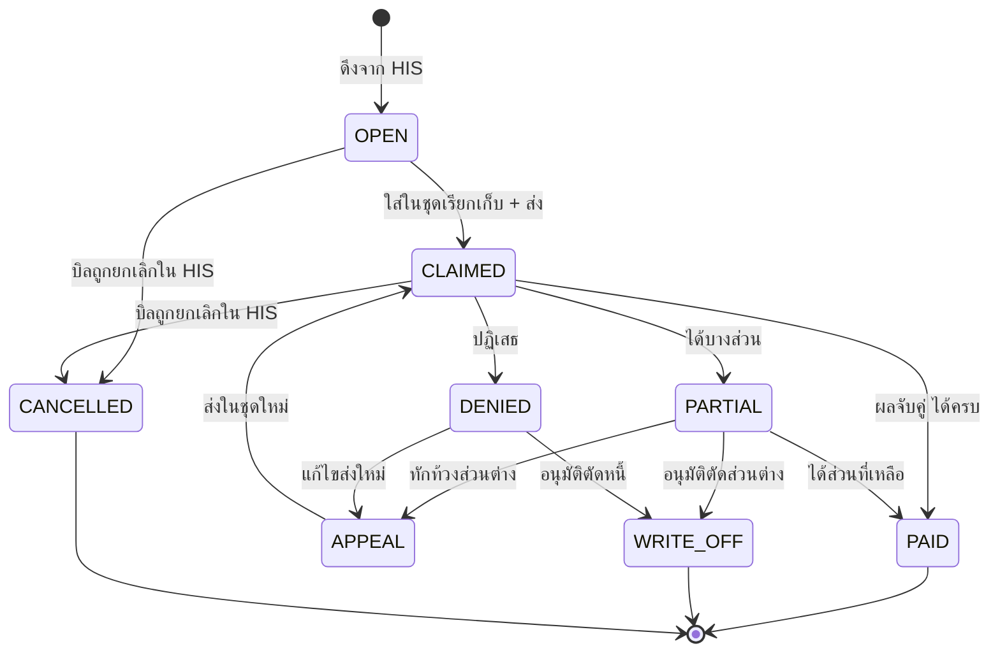

# ออกแบบ: ระบบติดตามลูกหนี้สิทธิ (เรียกเก็บจากหน่วยงาน)

> สถานะ: **ร่างออกแบบ — รอฝ่ายการเงินทบทวน** · 13 พ.ย. 2569
> ขอบเขต: ลูกหนี้ที่ต้องเรียกเก็บจากผู้จ่าย/หน่วยงาน (ไม่ใช่ผู้ป่วยชำระเอง) ตั้งแต่ตั้งหนี้ → ส่งเรียกเก็บ → นำเข้าผลที่หน่วยงานจ่าย → จับคู่กับหนี้ที่ตั้งไว้ → ติดตามยอดค้าง
> **แยกตาม 4 สิทธิ์เดียวกับรายงานตามปีงบประมาณ**: สปสช. · กรมบัญชีกลาง · อปท. · ประกันสังคม (ใช้กติกาจัดสิทธิ์ชุดเดียวกัน — ข้อ 3.1)

---

## 1. ปัญหาและเป้าหมาย

**ตอนนี้**
- HIS รู้ว่ามี "บิลเครดิต" (ลูกหนี้สิทธิ) เท่าไร แต่ **ไม่มีข้อมูลว่าหน่วยงานจ่ายแล้วเท่าไร** ใน HIS ไม่มีตารางรับชำระจากผู้จ่ายสิทธิ (finance.md §8)
- ผลการจ่ายมาจากหน่วยงานในรูปไฟล์ (statement / REP / หนังสือแจ้งโอน) ฝ่ายการเงินต้องเทียบเองทีละรายการ

**เป้าหมาย**
1. เห็นยอดลูกหนี้คงค้าง **แยกตาม 4 สิทธิ์** แล้วแยกย่อยตามผู้จ่าย, OPD/IPD, อายุหนี้ (aging), สถานะ
2. ติดตามว่ารายการไหนส่งเรียกเก็บแล้ว, ได้รับแล้ว, ได้บางส่วน, ถูกปฏิเสธ
3. นำเข้าไฟล์ผลจากหน่วยงาน (ผ่าน **Excel template กลาง**) แล้ว **จับคู่อัตโนมัติ** กับหนี้ที่ตั้งไว้ ด้วย VN/AN หรือ HN + วันที่เปิด visit
4. ทุกการเปลี่ยนแปลงมีประวัติ ตรวจย้อนได้ (ใคร ทำอะไร เมื่อไร)

**ไม่อยู่ในขอบเขต (รอบแรก)**
- ไม่เขียนกลับ HIS (HIS อ่านอย่างเดียว)
- ไม่ส่งไฟล์เบิกแทนโปรแกรมส่งเบิกเดิม (e-Claim, DBF ฯลฯ)
- ไม่ลงบัญชีแยกประเภท (ระบบบัญชีภายนอกยังเป็นตัวจริง)

---

## 2. คำศัพท์

| คำ | ความหมายในระบบนี้ |
|---|---|
| **ลูกหนี้ (Receivable)** | 1 บิลเครดิตใน HIS ที่เรียกเก็บกับผู้จ่าย 1 ราย = 1 รายการลูกหนี้ |
| **สิทธิ์ (Scheme)** | 1 ใน 4 สิทธิ์ของรายงาน: `NHSO` สปสช. · `CSMBS` กรมบัญชีกลาง · `LGO` อปท. · `SSO` ประกันสังคม (`ReferenceValues` หมวด `PAYOR_SCHEME` มีอยู่แล้ว) |
| **ผู้จ่าย (Payor)** | `PayorDetail` ใน HIS (ละเอียดกว่าสิทธิ์ เช่น สปสช. มีหลายผู้จ่าย) · กลุ่มผู้จ่าย = `PYRACAT` |
| **ชุดเรียกเก็บ (Claim batch)** | กลุ่มลูกหนี้ที่ส่งเรียกเก็บพร้อมกันในงวดเดียวกัน กับผู้จ่ายเดียวกัน |
| **ผลการเรียกเก็บ (Remittance)** | ข้อมูลที่หน่วยงานแจ้งกลับว่าจ่าย/ไม่จ่ายรายการไหน เท่าไร |
| **จับคู่ (Match)** | ผูก 1 แถวในไฟล์ผล กับ 1 รายการลูกหนี้ |
| **VN / AN** | เลข visit ผู้ป่วยนอก / ผู้ป่วยใน (`PatientVisitID.Identifier` ยาวสูงสุด 10) |
| **HN** | `Patient.PASID` ยาว 4–9 ตัว (ห้ามเก็บใน VARCHAR(8)) |

---

## 3. ภาพรวม Flow

```
 HIS (อ่านอย่างเดียว)                          QSHC_Financial (แอปเขียน)
 ─────────────────────                         ──────────────────────────────────────────────
 PatientBill (บิลเครดิต,           ① ตั้งหนี้      ┌──────────────────────┐
 IsPaymentComplete='N')  ─────────────────────► │  ArReceivables        │  สถานะ OPEN
 + PatientVisitPayor                (ทุกคืน +    │  (1 แถว = 1 บิลเครดิต) │
 + PayorDetail / PYRACAT            กดดึงเอง)    └──────────┬───────────┘
                                                            │ ② จัดชุดเรียกเก็บ (เลือกผู้จ่าย + งวด)
                                                            ▼
                                                 ┌──────────────────────┐
                                                 │  ArClaimBatches       │  สถานะลูกหนี้ CLAIMED
                                                 │  ส่งออก Excel รายการ   │  ──► ส่งหน่วยงาน (นอกระบบ)
                                                 └──────────┬───────────┘
                                                            │
 หน่วยงานจ่าย/แจ้งผล (statement, REP, หนังสือโอน)           │
        │                                                   │
        ▼  ③ เจ้าหน้าที่แปลงลง Excel template กลาง          │
 ┌──────────────────────┐     ④ นำเข้า + ตรวจรูปแบบ         │
 │ ไฟล์ Excel ผลการจ่าย  │ ─────────────────────────────►  ┌─┴────────────────────┐
 └──────────────────────┘                                │  ArImportBatches/Rows │
                                                          └──────────┬───────────┘
                                                                     │ ⑤ จับคู่อัตโนมัติ
                                                                     │   VN/AN → HN+วันที่ → HN+วันที่+ยอด
                                                                     ▼
                                                          ┌──────────────────────┐
                                                          │ หน้าตรวจผลจับคู่       │ ⑥ เจ้าหน้าที่ยืนยัน/แก้คู่
                                                          └──────────┬───────────┘
                                                                     │ ⑦ ยืนยัน → บันทึกรับชำระ
                                                                     ▼
                                                          ┌──────────────────────┐
                                                          │ ArPayments            │ สถานะ PAID / PARTIAL / DENIED
                                                          └──────────┬───────────┘
                                                                     │ ⑧ ติดตาม
                                                                     ▼
                                              Dashboard aging · รายงาน · แจ้งเตือน Telegram (หนี้เกินกำหนด)
```

### 3.1 การแยกสิทธิ์ (เหมือนรายงานตามปีงบประมาณ)

ใช้ `FiscalReportOptions.SchemeOf()` และ config `Reports:Fiscal:Schemes` ตัวเดิม — แก้ที่เดียว รายงานและลูกหนี้เปลี่ยนตามกัน

| สิทธิ์ | รหัส | จัดจาก |
|---|---|---|
| สปสช. | `NHSO` | PYRACAT `A` (ยกเว้นผู้จ่ายที่ชื่อมี "อปท") |
| กรมบัญชีกลาง | `CSMBS` | PYRACAT `B`, `V` |
| อปท. | `LGO` | ชื่อผู้จ่าย/เงื่อนไขมีคำว่า "อปท" (เช่น สปสช(อปท)) **มาก่อน** หรือ PYRACAT `P`, `W` |
| ประกันสังคม | `SSO` | PYRACAT `C`, `N`, `O` |

- บิลเครดิตที่ไม่เข้า 4 สิทธิ์ (บริษัทประกัน, พรบ., หน่วยงานเปิด Credit ฯลฯ) **ไม่อยู่ในรอบแรก** — เพิ่มสิทธิ์ใน config ภายหลังได้
- ทุกหน้า มี **แท็บเลือกสิทธิ์** แบบเดียวกับหน้ารายงาน (สปสช. / กรมบัญชีกลาง / อปท. / ประกันสังคม) และทุกตารางมีคอลัมน์ `SchemeCode`
- ชุดเรียกเก็บ และไฟล์นำเข้า **1 ชุด/ไฟล์ = 1 สิทธิ์** · การจับคู่ค้นเฉพาะลูกหนี้ของสิทธิ์นั้น
- สปสช. แสดงมิติ **ในเขต/นอกเขต** เพิ่ม (กติกา `IsOutOfZone` เดิม) — สิทธิ์อื่นไม่แยก เหมือนรายงาน

---

## 4. สถานะลูกหนี้

เก็บใน `ReferenceValues` หมวด `AR_STATUS` (ไม่ใช้ enum)

| รหัส | ชื่อ | ความหมาย |
|---|---|---|
| `OPEN` | ตั้งหนี้ | ดึงมาจาก HIS ยังไม่ได้ส่งเรียกเก็บ |
| `CLAIMED` | ส่งเรียกเก็บแล้ว | อยู่ในชุดเรียกเก็บที่ส่งแล้ว รอผล |
| `PARTIAL` | ได้รับบางส่วน | ได้เงินน้อยกว่ายอดหนี้ ยังมียอดคงเหลือ |
| `PAID` | ได้รับครบ | ยอดคงเหลือ = 0 (หรืออยู่ในเกณฑ์ปัดเศษ) |
| `DENIED` | ถูกปฏิเสธ | หน่วยงานไม่จ่าย / ติด C / ติด Deny พร้อมเหตุผล |
| `APPEAL` | อุทธรณ์ / ส่งใหม่ | แก้ไขแล้วส่งเรียกเก็บใหม่ |
| `WRITE_OFF` | ตัดหนี้ | อนุมัติตัดเป็นหนี้สูญ/ส่วนต่าง (ต้องมีผู้อนุมัติ) |
| `CANCELLED` | ยกเลิก | บิลใน HIS ถูกยกเลิก/คืนเงินหลังตั้งหนี้ |



กติกา
- สถานะเปลี่ยนตาม **ยอดคงเหลือ** เป็นหลัก ไม่ให้แก้สถานะเองตรง ๆ ยกเว้น `DENIED → APPEAL`, `WRITE_OFF` (ต้องเป็นผู้มีสิทธิ์อนุมัติ)
- ทุกการเปลี่ยนสถานะลง `ArStatusHistories` (จาก → ไป, ผู้ทำ, เหตุผล, เวลาไทย `DateTime.Now`)

---

## 5. ขั้นตอนการทำงานแต่ละส่วน

### ① ตั้งหนี้ (ดึงจาก HIS)

**แหล่งข้อมูล** (SQL ใหม่ `Database/his/queries/ar-credit-bills.sql` — SELECT + NOLOCK)
- `PatientBill` ที่ `IsPaymentComplete = 'N'` (บิลเครดิต), `StatusFlag='A'`, `IsRefund IS NULL`
- หมวดบิล OPD/IPD: `BLCATUID IN (4321, 64739, 4322, 64740)`, ตัด Free bill (`BLTYPUID 23377`)
- ผู้จ่ายจาก `PatientBill.PatientVisitPayorUID → PatientVisitPayor → PayorDetail (PYRACAT)`
- กรองเฉพาะ 4 สิทธิ์ (PYRACAT + คำในชื่อผู้จ่าย ตามข้อ 3.1 — ใช้ placeholder `/*PAYOR_CATEGORIES*/`, `/*PAYOR_NAME_FILTER*/` แบบ `report-fiscal-payor.sql`) แล้วแอปจัด `SchemeCode` ด้วย `SchemeOf()`
- **ตัด** payor `PDQSHC001` (ส่วนเกินสิทธิ์) — เหมือน AR interface เดิม (`pRepCSInterfaceAR`)
- ยอด = `SUM(PatientBilledItem.NetAmount)` ของบิล (finance.md §5)
- คีย์สำหรับจับคู่: VN/AN (`PatientVisitID.Identifier`), HN (`Patient.PASID`), วันที่เปิด visit (`PatientVisit.StartDttm`), วันที่ D/C (IPD)

**การ sync**
- Worker ทุกคืน (ใช้แบบเดียวกับ `FiscalRefreshWorker`) ดึงบิลเครดิตย้อนหลัง N วัน (ค่าเริ่มต้น 90) + ปุ่ม "ดึงข้อมูล" ที่หน้า Admin
- **Upsert ตาม `HisBillUid`** — บิลเดิมไม่สร้างซ้ำ, ยอดเปลี่ยน → อัปเดตยอดหนี้ + ลงประวัติ
- บิลที่หายไป/ถูกยกเลิกใน HIS → สถานะ `CANCELLED` (ถ้ามีรับชำระแล้ว → ขึ้นแจ้งเตือนให้ตรวจ ไม่เปลี่ยนเอง)

### ② จัดชุดเรียกเก็บ

- เลือก **สิทธิ์** (แท็บ) + OPD/IPD + (ไม่บังคับ) ผู้จ่าย + ช่วงวันที่ (วันออกบิล / วัน D/C) → ระบบแสดงลูกหนี้ `OPEN` / `APPEAL`
- เลือกทั้งหมดหรือบางรายการ → สร้าง `ArClaimBatches` (เลขชุดมีรหัสสิทธิ์ เช่น `NHSO-I-2569-11-0001`)
- ปุ่ม **ส่งออก Excel รายการเรียกเก็บ** — ไฟล์นี้เป็นรูปแบบเดียวกับ template ผลการจ่าย (ข้อ 6) โดยเติม VN/AN, HN, วันที่, ยอดเรียกเก็บไว้แล้ว → ส่งให้หน่วยงาน หรือใช้เป็นต้นฉบับกรอกผลกลับ
- กด "ส่งแล้ว" ใส่วันที่ส่ง/เลขหนังสือ → ลูกหนี้ในชุดเป็น `CLAIMED`

### ③–④ นำเข้าผลการเรียกเก็บ

- หน้า **นำเข้าผลการเรียกเก็บ**: เลือก **สิทธิ์** (บังคับ), (ไม่บังคับ) ผู้จ่าย / ชุดเรียกเก็บ, เลขที่ statement, วันที่รับโอน → อัปโหลด Excel
- ตรวจไฟล์ก่อน (ไม่บันทึก): หัวคอลัมน์ตรง template, ชนิดข้อมูล, แถวที่ไม่มีคีย์ → แสดงตัวอย่าง + แถวผิดพร้อมเหตุผล
- **กันนำเข้าซ้ำ**: เก็บ SHA-256 ของไฟล์ — ไฟล์เดิมนำเข้าอีกไม่ได้ (ยกเว้นยกเลิกครั้งก่อน); แถวที่ (ผู้จ่าย + เลข statement + VN/AN) ซ้ำกับที่ยืนยันแล้ว → ขึ้น `DUPLICATE`
- ไฟล์ต้นฉบับ **ไม่เก็บ** หลังประมวลผล (มี PHI) — เก็บเฉพาะแถวที่อ่านได้ใน `ArImportRows`

### ⑤ จับคู่อัตโนมัติ

ลองตามลำดับ หยุดที่ขั้นแรกที่ได้ผลชัดเจน — ค้นเฉพาะลูกหนี้ของ **สิทธิ์เดียวกับไฟล์** (และผู้จ่าย / ชุดเรียกเก็บ ถ้าระบุ) · VN/AN ที่เจอแต่เป็นลูกหนี้ของสิทธิ์อื่น → `NOT_FOUND` พร้อมข้อความ "เป็นลูกหนี้สิทธิ์ …" ไม่จับคู่ข้ามสิทธิ์

| ขั้น | คีย์ | เงื่อนไขผ่าน |
|---|---|---|
| 1 | **VN/AN** (+ เลขบิล ถ้ามี) | พบลูกหนี้ 1 รายการ |
| 2 | **HN + วันที่เปิด visit** (IPD ใช้ วันที่ admit หรือ D/C ก็ได้) | พบ 1 รายการ |
| 3 | **HN + วันที่ ± N วัน + ยอดใกล้เคียง** (ค่าเริ่มต้น ±1 วัน, ยอดต่าง ≤ 1%) | พบ 1 รายการ — ผล `SUGGESTED` ต้องให้คนยืนยัน |

ผลการจับคู่ (`ReferenceValues` หมวด `AR_MATCH_RESULT`)

| รหัส | ความหมาย | ต้องทำอะไร |
|---|---|---|
| `MATCHED` | คู่ชัด ยอดได้ = ยอดค้าง | ยืนยันทั้งชุดได้ทีเดียว |
| `AMOUNT_DIFF` | คู่ชัด แต่ยอดต่าง (ได้น้อย/มากกว่า) | ตรวจ ใส่เหตุผลส่วนต่าง |
| `DENIED` | หน่วยงานแจ้งไม่จ่าย (ยอดได้ 0 + มีรหัส/เหตุผล) | ยืนยัน → ลูกหนี้ `DENIED` |
| `SUGGESTED` | ได้จากขั้น 3 | คนยืนยันทีละรายการ |
| `MULTIPLE` | พบหลายรายการ (เช่น 1 visit หลายบิล) | เลือกคู่เอง หรือ **กระจายยอด** |
| `NOT_FOUND` | ไม่พบลูกหนี้ | ตรวจ (อาจยังไม่ sync, ผิดผู้จ่าย) — ค้นแล้วผูกเอง หรือพักไว้ |
| `DUPLICATE` | แถวนี้เคยยืนยันไปแล้ว | ข้าม |
| `INVALID` | ข้อมูลไม่ครบ/ผิดรูปแบบ | แก้ไฟล์แล้วนำเข้าใหม่ |

**1 visit หลายบิล** (finance.md §2): ถ้าไฟล์ระบุแค่ VN/AN → ระบบกระจายยอดที่ได้ให้บิลของผู้จ่ายนั้นใน visit ตามสัดส่วนยอดค้าง (แสดงให้ยืนยันก่อน)

### ⑥–⑦ ตรวจและยืนยัน

- หน้า **ตรวจผลจับคู่** แสดงสรุปตามผล (MATCHED n รายการ / AMOUNT_DIFF n / …) + ยอดรวมในไฟล์ vs ยอดที่จับคู่ได้
- ยืนยัน → สร้าง `ArPayments` (1 แถวไฟล์ อาจกระจายเป็นหลาย payment), คำนวณยอดคงเหลือ, เปลี่ยนสถานะ
- **ยกเลิกการนำเข้าทั้งไฟล์ได้** (ย้อน payment ที่มาจากไฟล์นั้น + ลงประวัติ) — ไม่ลบแถวจริง (soft delete ตาม `BaseEntity.IsActive`)

### ⑧ ติดตาม

- **Dashboard ลูกหนี้**: card 4 สิทธิ์เรียงกัน (ยอดคงค้าง, จำนวนราย, % ได้รับ) → คลิกเข้าสิทธิ์ดูแยก OPD/IPD, ผู้จ่าย, aging (0–30 / 31–60 / 61–90 / 91–180 / 180+ วัน นับจากวันออกบิล หรือวัน D/C ตามที่การเงินเลือก), อัตราได้รับ/ปฏิเสธ
- **รายการลูกหนี้**: แท็บสิทธิ์ + กรอง OPD/IPD, ผู้จ่าย, สถานะ, ช่วงวันที่, aging, VN/AN · ส่งออก Excel
- **แจ้งเตือน Telegram** (ใช้ `ITelegramNotifier` ที่มีแล้ว): สรุปรายสัปดาห์ — ยอดเกิน 90 วัน, ไฟล์นำเข้าที่ค้างตรวจ — **ไม่มี HN/ชื่อในข้อความ**

---

## 6. Excel template ผลการเรียกเก็บ

ไฟล์ **แยกต่อสิทธิ์** `AR_REMITTANCE_{สิทธิ์}.xlsx` เช่น `AR_REMITTANCE_NHSO.xlsx` — คอลัมน์เหมือนกันทุกสิทธิ์ ต่างกันที่หัวกระดาษ (ชื่อสิทธิ์) และรายการรหัสเหตุผลใน dropdown — ดาวน์โหลดได้ 2 แบบ
1. **template เปล่า** (หน้า นำเข้าผล ตามแท็บสิทธิ์ที่เลือก)
2. **template จากชุดเรียกเก็บ** — เติม VN/AN, HN, วันที่, ยอดเรียกเก็บไว้แล้ว เหลือกรอกยอดที่ได้ (จับคู่ขั้น 1 ได้ 100%)

ใน template มีเซลล์ซ่อน `รหัสสิทธิ์` (เช่น `NHSO`) — นำเข้าไฟล์ผิดสิทธิ์ (เลือกแท็บ กรมบัญชีกลาง แต่ไฟล์เป็น สปสช.) ระบบเตือนและไม่ให้นำเข้า

### Sheet `ผลการเรียกเก็บ` (แถว 1 = หัวคอลัมน์ ห้ามแก้ชื่อ)

| คอลัมน์ | ชื่อหัว | บังคับ | ชนิด / รูปแบบ | หมายเหตุ |
|---|---|---|---|---|
| A | `ลำดับ` | | ตัวเลข | |
| B | `VN/AN` | ✔* | ข้อความ ≤ 10 | คีย์หลักในการจับคู่ |
| C | `HN` | ✔* | ข้อความ ≤ 9 (ตั้งเป็น Text กันเลข 0 หน้าหาย) | |
| D | `วันที่เปิด visit` | ✔* | วันที่ `dd/MM/yyyy` รับทั้ง พ.ศ. และ ค.ศ. (ปี > 2400 = พ.ศ.) | IPD ใส่วันที่ admit |
| E | `วันที่จำหน่าย` | | วันที่ | IPD |
| F | `เลขที่บิล` | | ข้อความ | ช่วยแยก 1 visit หลายบิล |
| G | `ยอดเรียกเก็บ` | | ทศนิยม 2 ตำแหน่ง | ยอดที่ส่งไป (ใช้ตรวจ) |
| H | `ยอดที่ได้รับ` | ✔ | ทศนิยม 2 ตำแหน่ง ≥ 0 | 0 = ไม่จ่าย |
| I | `ยอดปฏิเสธ/หัก` | | ทศนิยม | |
| J | `รหัสเหตุผล` | | เลือกจาก dropdown (sheet `ค่าอ้างอิง`) | เช่น รหัส C/Deny ของ สปสช. |
| K | `รายละเอียดเหตุผล` | | ข้อความ ≤ 500 | |
| L | `เลขที่ statement/REP` | | ข้อความ | ถ้าว่างใช้ค่าที่กรอกตอนนำเข้า |
| M | `วันที่โอนเงิน` | | วันที่ | ถ้าว่างใช้ค่าที่กรอกตอนนำเข้า |
| N | `หมายเหตุ` | | ข้อความ | |

\* ต้องมี **VN/AN** หรือ **HN + วันที่เปิด visit** อย่างน้อยหนึ่งชุด

### Sheet อื่น
- `คำอธิบาย` — วิธีกรอก, ตัวอย่าง 2 แถว (ข้อมูลสมมติ), กติกาวันที่ พ.ศ./ค.ศ.
- `ค่าอ้างอิง` — รายการรหัสเหตุผล **ของสิทธิ์นั้น** (จาก `ReferenceValues` หมวด `AR_DENY_REASON_{สิทธิ์}` เช่น `AR_DENY_REASON_NHSO` = รหัส C/Deny ของ สปสช.) สำหรับ dropdown

### การตรวจตอนนำเข้า
- อ่านด้วย EPPlus (มีในโปรเจกต์แล้ว), หา sheet ตามชื่อ, ตรวจหัวคอลัมน์ตามชื่อ (ลำดับสลับได้)
- ตัดช่องว่าง, HN/VN เป็นข้อความเสมอ (รับเลขที่ Excel แปลงเป็นตัวเลขแล้วแปลงกลับ)
- แถวว่างทั้งแถวข้าม · จำกัด 20,000 แถว/ไฟล์ · ขนาด ≤ 10 MB · เฉพาะ `.xlsx`

### ระยะถัดไป: รูปแบบไฟล์ของแต่ละหน่วยงาน
เมื่อได้ไฟล์จริง (เช่น REP/STM ของ สปสช., statement กรมบัญชีกลาง) เพิ่ม **ตัวแปลงรูปแบบ** (mapping คอลัมน์ต่อหน่วยงาน เก็บใน `ArImportFormats`) ให้นำเข้าไฟล์ต้นฉบับได้เลยโดยไม่ต้องคัดลอกลง template

---

## 7. โครงสร้างข้อมูล (QSHC_Financial บน .162)

ทุกตาราง inherit `BaseEntity` (Id, CreatedAt, UpdatedAt, CreatedBy, UpdatedBy, IsActive) · เปลี่ยน schema ผ่าน EF migration + สร้าง `QSHC_Financial-migrations.sql` ใหม่ · ไม่ใช้ enum

```
ArReceivables 1──* ArClaimBatchItems *──1 ArClaimBatches
      │ 1
      ├──* ArPayments *──1 ArImportRows *──1 ArImportBatches
      └──* ArStatusHistories
```

| ตาราง | คอลัมน์สำคัญ |
|---|---|
| `ArReceivables` | `HisBillUid` (unique), **`SchemeCode`** (NHSO/CSMBS/LGO/SSO), `IsOutOfZone` (ใช้กับ สปสช.), `BillNumber`, `HisVisitUid` (ภายในเท่านั้น ห้ามส่งไปหน้าเว็บ), `VisitNumber` (VN/AN, 10), `Hn` (12), `PatientTypeCode` (O/I), `VisitStartDate`, `DischargeDate`, `BillDate`, `PayorCode`, `PayorName`, `PayorCategoryCode` (PYRACAT), `AgreementName`, `BilledAmount`, `PaidAmount`, `DeniedAmount`, `WriteOffAmount`, `OutstandingAmount`, `StatusCode` (AR_STATUS), `LastSyncedAt`, `RowVersion` |
| `ArClaimBatches` | `BatchNo` (unique), **`SchemeCode`**, `PatientTypeCode`, `PayorCode?`, `PeriodFrom`, `PeriodTo`, `SentDate`, `ReferenceDocNo`, `ItemCount`, `TotalAmount`, `StatusCode` (DRAFT/SENT) |
| `ArClaimBatchItems` | `ClaimBatchId`, `ReceivableId`, `ClaimedAmount` · unique (ClaimBatchId, ReceivableId) |
| `ArImportBatches` | **`SchemeCode`**, `PayorCode?`, `ClaimBatchId?`, `StatementNo`, `TransferDate`, `FileName`, `FileSha256` (unique ถ้า active), `RowCount`, `TotalReceived`, `StatusCode` (VALIDATED/CONFIRMED/CANCELLED), `ConfirmedBy`, `ConfirmedAt` |
| `ArImportRows` | `ImportBatchId`, `RowNo`, ค่าที่อ่านได้ทุกคอลัมน์ของ template, `MatchResultCode` (AR_MATCH_RESULT), `MatchStep` (1/2/3/MANUAL), `ReceivableId?`, `Message` |
| `ArPayments` | `ReceivableId`, `ImportRowId?`, `Amount`, `DeniedAmount`, `ReasonCode`, `TransferDate`, `StatementNo`, `SourceCode` (IMPORT/MANUAL/WRITE_OFF) |
| `ArStatusHistories` | `ReceivableId`, `FromStatus`, `ToStatus`, `Reason`, `ChangedBy`, `ChangedAt` |

**ReferenceValues**: ใช้หมวด `PAYOR_SCHEME` ที่มีอยู่ + หมวดใหม่ `AR_STATUS`, `AR_MATCH_RESULT`, `AR_DENY_REASON_NHSO` / `_CSMBS` / `_LGO` / `_SSO`, `AR_CLAIM_BATCH_STATUS`, `AR_IMPORT_STATUS`, `AR_PAYMENT_SOURCE`

**index**: `ArReceivables (SchemeCode, StatusCode, BillDate)`, `(SchemeCode, VisitNumber)`, `(SchemeCode, Hn, VisitStartDate)` — ใช้ตอนจับคู่

**ยอดคงเหลือ** = `BilledAmount − PaidAmount − WriteOffAmount` — คำนวณใหม่จาก `ArPayments` ที่ยัง active ทุกครั้งที่ยืนยัน/ยกเลิก (ไม่บวกลบสะสม เพื่อกันยอดเพี้ยน) · ยืนยัน/ยกเลิกทำในทรานแซกชันเดียว และไฟล์ที่ยืนยันแล้วยืนยันซ้ำไม่ได้

> **ตัดสินใจตอนพัฒนาระยะ 2:** ยอดปฏิเสธ (`DeniedAmount`) **ไม่หัก**ออกจากคงค้าง — ยังเป็นหนี้ที่ต้องติดตาม/อุทธรณ์ จนกว่าจะอนุมัติตัดหนี้ (ระยะ 4) · ถ้าฝ่ายการเงินต้องการให้ "ยอดหัก" บางประเภทปิดหนี้ทันที ต้องเพิ่มกติกาตามรหัสเหตุผล

---

## 8. หน้าจอและเมนู

Sidebar ระดับ 1 **ลูกหนี้สิทธิ** → ระดับ 2 = หน้าที่ตามตารางนี้ (แบบเดียวกับ "EDC") · ในแต่ละหน้ามี **แท็บ 4 สิทธิ์** ด้านบน แบบเดียวกับหน้ารายงานตามปีงบ (ไม่ทำเมนูระดับ 2 เป็นชื่อสิทธิ์ เพราะ 6 หน้า × 4 สิทธิ์ = 24 เมนู ยาวเกินไป) · แท็บที่เลือกจำไว้ข้ามหน้า (query string `scheme=`)

```
ลูกหนี้สิทธิ
 ├ ภาพรวมลูกหนี้        [ สปสช. | กรมบัญชีกลาง | อปท. | ประกันสังคม ]
 ├ รายการลูกหนี้        [ แท็บสิทธิ์ ]  OPD/IPD · ผู้จ่าย · สถานะ · aging
 ├ ชุดเรียกเก็บ
 ├ นำเข้าผลการเรียกเก็บ
 ├ ตรวจผลจับคู่
 └ ตัดหนี้ (อนุมัติ)
```

| เมนู | หน้าที่ |
|---|---|
| ภาพรวมลูกหนี้ | card 4 สิทธิ์ + Dashboard aging ของสิทธิ์ที่เลือก, ยอดตามผู้จ่าย, กราฟแนวโน้มได้รับ/ปฏิเสธ |
| รายการลูกหนี้ | ค้น/กรอง, ดูรายละเอียด + ประวัติสถานะ + payment, ส่งออก Excel |
| ชุดเรียกเก็บ | สร้างชุด, ส่งออก Excel, บันทึกส่ง |
| นำเข้าผลการเรียกเก็บ | ดาวน์โหลด template, อัปโหลด, ตรวจไฟล์ |
| ตรวจผลจับคู่ | ยืนยัน/แก้คู่/กระจายยอด/ยกเลิกไฟล์ |
| ตัดหนี้ (อนุมัติ) | รายการขอตัดหนี้ รออนุมัติ |

Admin: หน้า ตั้งค่าระบบ เพิ่มปุ่ม "ดึงลูกหนี้จาก HIS" + progress (แบบดึงข้อมูลปีงบ), ค่าตั้ง เช่น จำนวนวันย้อนหลัง, เกณฑ์ปัดเศษ, ±วันของขั้น 3

---

## 9. สิทธิ์และข้อมูลผู้ป่วย (PHI)

| การกระทำ | Admin | การเงิน (Cashier*) | ผู้อนุมัติตัดหนี้ | ทั่วไป |
|---|---|---|---|---|
| ดู Dashboard/รายการ (ไม่มี HN/ชื่อ) | ✔ | ✔ | ✔ | ✘ |
| สร้างชุด / นำเข้า / ยืนยันจับคู่ | ✔ | ✔ | ✔ | ✘ |
| อนุมัติตัดหนี้ | ✔ | ✘ | ✔ | ✘ |
| เห็น HN | ✔ (audit) | **ต้องตัดสินใจ** (ดูข้อ 12) | | ✘ |

- **กติกาปัจจุบัน: HN/ชื่อแสดงเฉพาะ Admin + บันทึก audit** — งานจับคู่ใช้ HN ฝั่ง server ได้โดยไม่ต้องแสดง แต่หน้าตรวจ `NOT_FOUND` / `MULTIPLE` เจ้าหน้าที่การเงินอาจต้องเห็น HN จึงเป็นเรื่องที่ต้องตัดสินใจ
- ไม่เก็บชื่อ-สกุลผู้ป่วยใน QSHC_Financial (ดึงจาก HIS ตอนแสดงเฉพาะผู้มีสิทธิ์)
- ไม่เก็บไฟล์ Excel ต้นฉบับ · ไม่เขียน HN/ชื่อลง log · Telegram ส่งเฉพาะตัวเลขรวม
- `HisVisitUid` ใช้ภายใน ห้ามส่งไปหน้าเว็บ (ใช้ `Id` ของ `ArReceivables` แทน)

---

## 10. กรณีพิเศษ

| กรณี | วิธีจัดการ |
|---|---|
| visit เดียวมีลูกหนี้หลายสิทธิ์ (เช่น สปสช. + อปท.) | แยกเป็นลูกหนี้คนละสิทธิ์ตามบิล · แต่ละไฟล์นำเข้าเห็นเฉพาะสิทธิ์ของตน |
| 1 visit หลายบิล (หลายผู้จ่าย) | จับคู่เฉพาะผู้จ่ายเดียวกัน · ผู้จ่ายเดียวหลายบิล → `MULTIPLE` + กระจายยอดตามสัดส่วน |
| ได้เกินยอดหนี้ | `AMOUNT_DIFF` · ยอดคงเหลือติดลบ → แสดงในรายงาน "รับเกิน" ให้ตรวจ ไม่ปัดทิ้ง |
| หน่วยงานจ่ายหลายงวด | หลาย `ArPayments` ต่อ 1 ลูกหนี้ → `PARTIAL` จนครบ |
| บิลแก้ยอดใน HIS หลังส่งเรียกเก็บ | sync อัปเดต `BilledAmount` + ลงประวัติ + ธง "ยอดเปลี่ยนหลังส่ง" |
| บิลถูกยกเลิก/คืนเงินใน HIS | `CANCELLED` · ถ้ามี payment แล้ว → แจ้งเตือนให้ตรวจ |
| นำเข้าไฟล์ผิด | ยกเลิกทั้งไฟล์ได้ ย้อน payment ทั้งหมดของไฟล์ |
| ปี พ.ศ./ค.ศ. ปนกัน | ปี > 2400 = พ.ศ. ลบ 543 · วันที่จาก Excel ที่เป็นตัวเลข serial แปลงด้วย `DateTime.FromOADate` |
| HN 9 หลัก / เลข 0 นำหน้า | เก็บเป็นข้อความเสมอ, template ตั้งคอลัมน์เป็น Text |
| ส่งต่อ/นอกเขต | ใช้ `AgreementName` + กติกานอกเขตเดิม (`IsOutOfZone`) แสดงเป็นมิติในรายงาน |

---

## 11. แผนการพัฒนา

| ระยะ | งาน | ผลที่ได้ |
|---|---|---|
| **1. ตั้งหนี้ + ดู** | SQL ดึงบิลเครดิต 4 สิทธิ์, `ArReceivables`, worker sync, หน้ารายการ + Dashboard aging พร้อมแท็บสิทธิ์ | เห็นยอดค้างแยก 4 สิทธิ์ / ผู้จ่าย / อายุหนี้ |
| **2. นำเข้า + จับคู่** | template, นำเข้า/ตรวจ, จับคู่ 3 ขั้น, หน้าตรวจ, `ArPayments`, ยกเลิกไฟล์ | ปิดหนี้จากไฟล์หน่วยงานได้ |
| **3. ชุดเรียกเก็บ** | `ArClaimBatches`, ส่งออก Excel, สถานะ CLAIMED, template เติมข้อมูล | ติดตามว่าอะไรส่งแล้ว/ยัง |
| **4. ปฏิเสธ/อุทธรณ์/ตัดหนี้** | DENIED/APPEAL/WRITE_OFF + อนุมัติ, รายงาน | ครบวงจร |
| **5. ตัวแปลงไฟล์หน่วยงาน + แจ้งเตือน** | mapping ไฟล์ สปสช./กรมบัญชีกลาง, Telegram รายสัปดาห์ | ลดงานคัดลอกลง template |

ระยะ 1–2 ทำก่อนได้ (ใช้งานได้จริงโดยยังไม่ต้องมีชุดเรียกเก็บ)

### การทดสอบ
- Unit: กติกาจับคู่ทุกผล (MATCHED … INVALID), กระจายยอด, คำนวณยอดคงเหลือ, แปลงวันที่ พ.ศ./ค.ศ./serial, HN/VN ที่ Excel แปลงเป็นตัวเลข
- Integration (EF InMemory + HTTP): นำเข้า → ตรวจ → ยืนยัน → สถานะ, นำเข้าซ้ำถูกกัน, ยกเลิกไฟล์ย้อนยอด, สิทธิ์ตาม role, ไม่มี HN ใน HTML ของผู้ไม่ใช่ Admin
- ข้อมูลทดสอบเป็นค่าสมมติทั้งหมด

---

## 12. เรื่องที่ต้องให้ฝ่ายการเงินตัดสินใจ

1. **ลูกหนี้ตั้งจากอะไร**: บิลเครดิต (`IsPaymentComplete='N'`) ของ 4 สิทธิ์ ยกเว้นส่วนเกินสิทธิ์ ใช่หรือไม่ · กลุ่ม PYRACAT ของแต่ละสิทธิ์ใช้ชุดเดียวกับรายงานได้เลยหรือไม่ (เรื่องเดียวกับที่ค้างยืนยันของรายงาน)
2. **สิทธิ์เหมาจ่าย** (เช่น สปสช. OPD เหมาจ่ายรายหัว, ประกันสังคมเหมาจ่าย `O`) — ติดตามรายบิลด้วยหรือไม่ (มักไม่ได้รับรายบิล) · ถ้าไม่ ให้ตัดออกจากลูกหนี้ของสิทธิ์นั้น
3. **นับอายุหนี้จากวันไหน**: วันออกบิล หรือวันจำหน่าย (IPD) หรือวันส่งเรียกเก็บ
4. **ใครเห็น HN ได้**: คงกติกาเดิม (Admin เท่านั้น) หรือเพิ่ม role ใหม่ เช่น `ArOfficer` ที่เห็น HN ได้พร้อม audit
5. **ใครอนุมัติตัดหนี้** และเกณฑ์ปัดเศษ (เช่น ส่วนต่าง ≤ 1 บาท ถือว่าครบ)
6. **ตัวอย่างไฟล์จริงจากหน่วยงานของทั้ง 4 สิทธิ์** (ลบข้อมูลผู้ป่วยออก) — สปสช. (REP/STM), กรมบัญชีกลาง (STM), อปท., ประกันสังคม — เพื่อยืนยันคอลัมน์ template และทำตัวแปลงในระยะ 5
7. **รหัสเหตุผลการปฏิเสธ** ที่ใช้จริง **แยกตามสิทธิ์** (รายการเริ่มต้นของ `AR_DENY_REASON_{สิทธิ์}`)
8. ต้องเชื่อมกับ **AR interface เดิม** (`pRepCSInterfaceAR`, ระบบบัญชีภายนอก) หรือไม่ — ถ้าระบบบัญชีมีข้อมูลรับชำระอยู่แล้ว อาจดึงจากที่นั่นแทนการนำเข้า Excel
